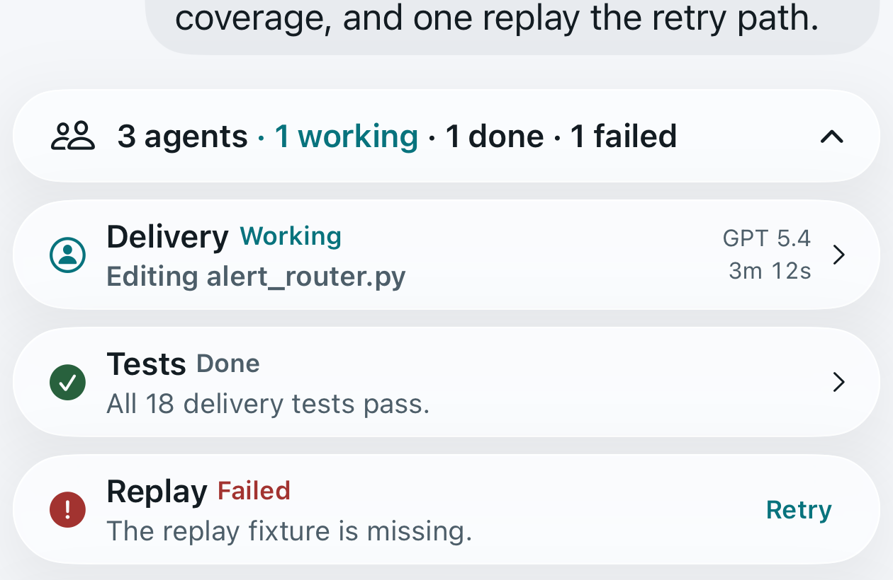
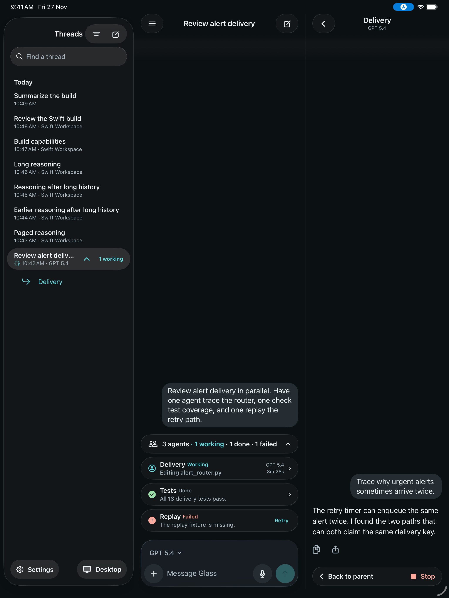

# Glass iOS round 8: agents in the conversation

## Summary

- Group each agent launch in a Liquid Glass capsule. Expand it to see working, done, and failed agents, with live actions or results on the row. Long-press a working agent to stop it, or retry a failed assignment from its row.
- Prefetch each child's recent records and open them in the regular conversation timeline. The child has Stop and Back to parent controls, not a composer. On iPad the parent stays visible beside the child, and working children can expand under the parent in the sidebar.
- Show the working agent count and longest elapsed time in the existing Live Activity. No counter floats over the chat.
- Keep iPad sidebar controls 16 pt from the panel edges with 38 pt continuous corners. Hide the empty composer model rail while keeping model selection available. Transition from the chat header to the scrolling text with a gradual material fade.
- Use the existing session and teammate hub behind `POST /api/agent/stop` and `POST /api/agent/send`. Root stop uses the host's existing root cancel path; child stop targets only that agent.

## Simulator evidence

The iPhone 17 Pro Max captures are at native 3×. The iPad Pro 13-inch simulator renders at native 2×; iPad captures retain that resolution rather than being upscaled.

| Screen | Light | Dark |
| --- | --- | --- |
| iPhone, collapsed agents | [Light](https://github.com/wanazhar/glass/blob/ios-round8/pr-assets/glass-ios-round8/iphone-light-agents-collapsed.png?raw=true) | [Dark](https://github.com/wanazhar/glass/blob/ios-round8/pr-assets/glass-ios-round8/iphone-dark-agents-collapsed.png?raw=true) |
| iPhone, expanded agents | [Light](https://github.com/wanazhar/glass/blob/ios-round8/pr-assets/glass-ios-round8/iphone-light-agents-expanded.png?raw=true) | [Dark](https://github.com/wanazhar/glass/blob/ios-round8/pr-assets/glass-ios-round8/iphone-dark-agents-expanded.png?raw=true) |
| iPhone, child timeline and footer | [Light](https://github.com/wanazhar/glass/blob/ios-round8/pr-assets/glass-ios-round8/iphone-light-agent-thread.png?raw=true) | [Dark](https://github.com/wanazhar/glass/blob/ios-round8/pr-assets/glass-ios-round8/iphone-dark-agent-thread.png?raw=true) |
| iPad, collapsed agents | [Light](https://github.com/wanazhar/glass/blob/ios-round8/pr-assets/glass-ios-round8/ipad-light-agents-collapsed.png?raw=true) | [Dark](https://github.com/wanazhar/glass/blob/ios-round8/pr-assets/glass-ios-round8/ipad-dark-agents-collapsed.png?raw=true) |
| iPad, expanded agents | [Light](https://github.com/wanazhar/glass/blob/ios-round8/pr-assets/glass-ios-round8/ipad-light-agents-expanded.png?raw=true) | [Dark](https://github.com/wanazhar/glass/blob/ios-round8/pr-assets/glass-ios-round8/ipad-dark-agents-expanded.png?raw=true) |
| iPad, child inspector and nested sidebar | [Light](https://github.com/wanazhar/glass/blob/ios-round8/pr-assets/glass-ios-round8/ipad-light-agent-inspector.png?raw=true) | [Dark](https://github.com/wanazhar/glass/blob/ios-round8/pr-assets/glass-ios-round8/ipad-dark-agent-inspector.png?raw=true) |
| iPhone, collapsed / expanded details | [Collapsed](https://github.com/wanazhar/glass/blob/ios-round8/pr-assets/glass-ios-round8/iphone-light-agents-collapsed-zoom.png?raw=true) · [Expanded](https://github.com/wanazhar/glass/blob/ios-round8/pr-assets/glass-ios-round8/iphone-light-agents-expanded-zoom.png?raw=true) | [Collapsed](https://github.com/wanazhar/glass/blob/ios-round8/pr-assets/glass-ios-round8/iphone-dark-agents-collapsed-zoom.png?raw=true) · [Expanded](https://github.com/wanazhar/glass/blob/ios-round8/pr-assets/glass-ios-round8/iphone-dark-agents-expanded-zoom.png?raw=true) |
| iPad, collapsed / expanded details | [Collapsed](https://github.com/wanazhar/glass/blob/ios-round8/pr-assets/glass-ios-round8/ipad-light-agents-collapsed-zoom.png?raw=true) · [Expanded](https://github.com/wanazhar/glass/blob/ios-round8/pr-assets/glass-ios-round8/ipad-light-agents-expanded-zoom.png?raw=true) | [Collapsed](https://github.com/wanazhar/glass/blob/ios-round8/pr-assets/glass-ios-round8/ipad-dark-agents-collapsed-zoom.png?raw=true) · [Expanded](https://github.com/wanazhar/glass/blob/ios-round8/pr-assets/glass-ios-round8/ipad-dark-agents-expanded-zoom.png?raw=true) |
| iPhone, child timeline and footer detail | [Light](https://github.com/wanazhar/glass/blob/ios-round8/pr-assets/glass-ios-round8/iphone-light-agent-thread-zoom.png?raw=true) | [Dark](https://github.com/wanazhar/glass/blob/ios-round8/pr-assets/glass-ios-round8/iphone-dark-agent-thread-zoom.png?raw=true) |
| iPad, child footer / nested sidebar detail | [Footer](https://github.com/wanazhar/glass/blob/ios-round8/pr-assets/glass-ios-round8/ipad-light-agent-inspector-zoom.png?raw=true) · [Sidebar](https://github.com/wanazhar/glass/blob/ios-round8/pr-assets/glass-ios-round8/ipad-light-nested-sidebar-zoom.png?raw=true) | [Footer](https://github.com/wanazhar/glass/blob/ios-round8/pr-assets/glass-ios-round8/ipad-dark-agent-inspector-zoom.png?raw=true) · [Sidebar](https://github.com/wanazhar/glass/blob/ios-round8/pr-assets/glass-ios-round8/ipad-dark-nested-sidebar-zoom.png?raw=true) |
| iPad, sidebar top-right / bottom-left | [Top-right](https://github.com/wanazhar/glass/blob/ios-round8/pr-assets/glass-ios-round8/ipad-light-sidebar-top-right-zoom.png?raw=true) · [Bottom-left](https://github.com/wanazhar/glass/blob/ios-round8/pr-assets/glass-ios-round8/ipad-light-sidebar-bottom-left-zoom.png?raw=true) | [Top-right](https://github.com/wanazhar/glass/blob/ios-round8/pr-assets/glass-ios-round8/ipad-dark-sidebar-top-right-zoom.png?raw=true) · [Bottom-left](https://github.com/wanazhar/glass/blob/ios-round8/pr-assets/glass-ios-round8/ipad-dark-sidebar-bottom-left-zoom.png?raw=true) |
| iPhone, composer and header fade | [Composer](https://github.com/wanazhar/glass/blob/ios-round8/pr-assets/glass-ios-round8/iphone-light-composer.png?raw=true) · [Header](https://github.com/wanazhar/glass/blob/ios-round8/pr-assets/glass-ios-round8/iphone-light-header-fade.png?raw=true) | [Composer](https://github.com/wanazhar/glass/blob/ios-round8/pr-assets/glass-ios-round8/iphone-dark-composer.png?raw=true) · [Header](https://github.com/wanazhar/glass/blob/ios-round8/pr-assets/glass-ios-round8/iphone-dark-header-fade.png?raw=true) |
| iPad, sidebar and composer | [Light](https://github.com/wanazhar/glass/blob/ios-round8/pr-assets/glass-ios-round8/ipad-light-composer.png?raw=true) | [Dark](https://github.com/wanazhar/glass/blob/ios-round8/pr-assets/glass-ios-round8/ipad-dark-composer.png?raw=true) |
| iPad, chat header fade | [Light](https://github.com/wanazhar/glass/blob/ios-round8/pr-assets/glass-ios-round8/ipad-light-header-fade.png?raw=true) · [Detail](https://github.com/wanazhar/glass/blob/ios-round8/pr-assets/glass-ios-round8/ipad-light-header-fade-zoom.png?raw=true) | [Dark](https://github.com/wanazhar/glass/blob/ios-round8/pr-assets/glass-ios-round8/ipad-dark-header-fade.png?raw=true) · [Detail](https://github.com/wanazhar/glass/blob/ios-round8/pr-assets/glass-ios-round8/ipad-dark-header-fade-zoom.png?raw=true) |
| iPhone, Live Activity | [Island](https://github.com/wanazhar/glass/blob/ios-round8/pr-assets/glass-ios-round8/iphone-light-island-zoom.png?raw=true) · [Expanded](https://github.com/wanazhar/glass/blob/ios-round8/pr-assets/glass-ios-round8/iphone-light-island-expanded.png?raw=true) · [Lock screen](https://github.com/wanazhar/glass/blob/ios-round8/pr-assets/glass-ios-round8/iphone-light-lock-screen.png?raw=true) | [Island](https://github.com/wanazhar/glass/blob/ios-round8/pr-assets/glass-ios-round8/iphone-dark-island-zoom.png?raw=true) · [Expanded](https://github.com/wanazhar/glass/blob/ios-round8/pr-assets/glass-ios-round8/iphone-dark-island-expanded.png?raw=true) · [Lock screen](https://github.com/wanazhar/glass/blob/ios-round8/pr-assets/glass-ios-round8/iphone-dark-lock-screen.png?raw=true) |
| iPad, lock-screen Live Activity | [Light](https://github.com/wanazhar/glass/blob/ios-round8/pr-assets/glass-ios-round8/ipad-light-lock-screen.png?raw=true) | [Dark](https://github.com/wanazhar/glass/blob/ios-round8/pr-assets/glass-ios-round8/ipad-dark-lock-screen.png?raw=true) |
| iPhone, streaming reply | [Light](https://github.com/wanazhar/glass/blob/ios-round8/pr-assets/glass-ios-round8/iphone-light-streaming.mp4?raw=true) | [Dark](https://github.com/wanazhar/glass/blob/ios-round8/pr-assets/glass-ios-round8/iphone-dark-streaming.mp4?raw=true) |
| iPad, streaming reply | [Light](https://github.com/wanazhar/glass/blob/ios-round8/pr-assets/glass-ios-round8/ipad-light-streaming.mp4?raw=true) | [Dark](https://github.com/wanazhar/glass/blob/ios-round8/pr-assets/glass-ios-round8/ipad-dark-streaming.mp4?raw=true) |

### Agent navigation

- [iPhone walkthrough](https://github.com/wanazhar/glass/blob/ios-round8/pr-assets/glass-ios-round8/iphone-agent-navigation.mp4?raw=true): expand the group, open a child with its timeline already populated, stop it, and return to the parent.
- [iPad walkthrough](https://github.com/wanazhar/glass/blob/ios-round8/pr-assets/glass-ios-round8/ipad-agent-navigation.mp4?raw=true): keep the parent visible, open the inspector, expand the nested sidebar, stop the child, and return to the parent.

## Unsigned build

Glass 0.1.1 (20), Release for arm64 iOS. The unsigned IPA is produced by `apps/glass-ios/scripts/package-unsigned-ipa.sh Round8`; it requires signing before it can be installed on a device.

`unzip -l` lists the app and widget extension, with neither `_CodeSignature` nor `embedded.mobileprovision`.
